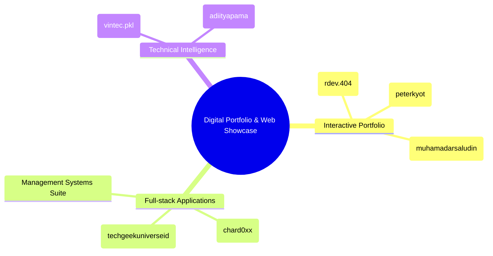

# 🚀 Curated Web, Portfolio & Project Inspirations
> Dokumentasi & Rangkuman Ide Proyek, Desain Antarmuka, dan Tech Stack dari Video Referensi.

---

## 📑 Daftar Isi
1. [Overview & Ringkasan Ekosistem](#-overview--ringkasan-ekosistem)
2. [Kurasi Web & Proyek dari Video](#-kurasi-web--proyek-dari-video)
   - [1. Interactive Terminal-Style Portfolio (`rdev.404`)](#1-interactive-terminal-style-portfolio-rdev404)
   - [2. LYNX - Smart POS & QR Code Ordering System (`techgeekuniverseid`)](#2-lynx---smart-pos--qr-code-ordering-system-techgeekuniverseid)
   - [3. Full-Stack Capstone & Multi-System Showcase (`chard0xx`)](#3-full-stack-capstone--multi-system-showcase-chard0xx)
   - [4. Three.js 3D Interactive Gamified Platform (`peterkyot`)](#4-threejs-3d-interactive-gamified-platform-peterkyot)
   - [5. Clean UI/UX & Design System Portfolio (`muhamadarsaludin`)](#5-clean-uiux--design-system-portfolio-muhamadarsaludin)
   - [6. Data Science & ML Model Diagnostic Dashboard (`vintec.pkl`)](#6-data-science--ml-model-diagnostic-dashboard-vintecpkl)
   - [7. Cybersecurity & Interactive Learning Roadmap (`_adiityapama`)](#7-cybersecurity--interactive-learning-roadmap-_adiityapama)
3. [Fitur-Fitur Kunci untuk Website Portofolio Masa Depan](#-fitur-fitur-kunci-untuk-website-portofolio-masa-depan)
4. [Rekomendasi Tech Stack Modern](#-rekomendasi-tech-stack-modern)

---

## 🌐 Overview & Ringkasan Ekosistem

Rangkuman ini mengonsolidasikan berbagai ide produk digital, arsitektur teknis, dan gaya antarmuka web modern yang diekstrak dari analisis video:



---

## 💻 Kurasi Web & Proyek dari Video

---

### 1. Interactive Terminal-Style Portfolio (`rdev.404`)
*Tema: Modern Developer Portfolio with Interactive File System Explorer*

* **Karakteristik Desain:**
  - Konsep antarmuka gabungan antara *minimalist modern dark mode* dengan *OS file explorer simulator*.
  - Section interaktif `ABOUT_ME.EXE` dengan navigasi file (`education.md`, `location.md`, `stack.json`).
* **Fitur Utama:**
  - **Dynamic Hero Section:** Teks berjalan, badge status ketersediaan (*"Available for select opportunities"*), dan tombol *Quick Action* (Download CV, View Projects).
  - **Tech Stack Badges:** Visualisasi keahlian (React, Next.js, JavaScript, Tailwind, Figma, CapCut).
  - **Service Offering Cards:** Static Website, Fullstack Dynamic Apps, UI/UX Optimization, Cloud Deployment & Ops.
* **Tech Stack:**
  `React` `Vite` `Tailwind CSS` `Framer Motion` `Lucide Icons`

---

### 2. LYNX - Smart POS & QR Code Ordering System (`techgeekuniverseid`)
*Tema: Aplikasi Web Point-of-Sale (POS) & Self-Ordering Restoran ("Bukan CRUD Biasa")*

* **Karakteristik Desain:**
  - Dual-interface: Antarmuka Pelanggan (Mobile Web) dan Dashboard Kasir / Dapur (Desktop/Tablet).
  - Clean food commerce cards dengan animasi status real-time.
* **Fitur Utama:**
  - **Dine-in QR Ordering:** Pelanggan scan QR code di meja untuk membuka menu, memilih varian, dan langsung checkout.
  - **Real-time Order Lifecycle:** Status pesanan live (`Pesanan Masuk` ➔ `Disiapkan` ➔ `Siap Disajikan` ➔ `Dibayar/Selesai`).
  - **Payment Gateway Integration:** Pembayaran otomatis via Midtrans (BCA Virtual Account, QRIS).
  - **Analytics & Export:** Laporan performa omset, menu terlaris, serta ekspor file Excel & PDF.
* **Tech Stack:**
  `Next.js / Laravel` `Tailwind CSS` `Midtrans API` `WebSocket / Supabase Realtime` `PostgreSQL`

---

### 3. Full-Stack Capstone & Multi-System Showcase (`chard0xx`)
*Tema: Enterprise & Public Sector Information System Portfolio*

* **Karakteristik Desain:**
  - Portofolio berbasis *Case Study Gallery* berfokus pada fungsionalitas dan penghargaan akademis/kompetisi.
* **Koleksi Proyek Unggulan:**
  1. **RFID-Based Student Attendance Monitoring:** Otomatisasi presensi dengan hardware RFID scanner, webcam capture otomatis foto siswa saat tap kartu, notifikasi email ke orang tua, dan export Google Drive. *(Best Capstone Paper & System)*.
  2. **PayTrack:** Sistem penggajian karyawan berbasis payroll & kompensasi terpusat.
  3. **DocuTrack:** Manajemen arsip surat, digital tagging, dan alur approval dokumen instansi.
  4. **DAGAN 360:** Sistem live tracking checkpoint lomba lari dengan dashboard rute.
  5. **OJTrackPro:** Manajemen magang mahasiswa (logbook, absensi, evaluasi pembimbing).
* **Tech Stack:**
  `Python (Django)` `PHP (CodeIgniter / Laravel)` `MySQL` `IoT / Hardware Integration` `Google API`

---

### 4. Three.js 3D Interactive Gamified Platform (`peterkyot`)
*Tema: Creative Web Development & WebGL 3D Experience*

* **Karakteristik Desain:**
  - Nuansa visual futuristik, partikel 3D, physics-based scroll animation, dan tipografi ekspresif.
* **Fitur & Komponen Kode:**
  - **Custom Shaders & Easing Engine:** Modul `easings.js` kustom (`power2.out`, `smoothstep` zoom controller).
  - **Camera Rig & Lerping:** `CameraRig.js` dengan kalkulasi smooth focal distance, gyro parallax, dan scroll lerp (0.075 - 0.08).
  - **3D Asset Pipeline:** Integrasi model `.glb` via DRACO compression (`loader_hand.glb`, `glass_shards.glb` dengan efek shatter saat scroll).
  - **Gamified Engagement:** Sistem reward XP interaktif (+100 XP, +200 XP, +500 XP) saat pengunjung mengeksplorasi halaman.
* **Tech Stack:**
  `Three.js` `GLSL Shaders` `GSAP / ScrollTrigger` `Vite` `WebGL / Draco Loader`

---

### 5. Clean UI/UX & Design System Portfolio (`muhamadarsaludin`)
*Tema: Human-Centered Design & Mobile/Web UI Engineering*

* **Karakteristik Desain:**
  - Minimalis, tipografi rapi (*high readability*), palet warna konsisten, struktur modular.
* **Fitur Utama:**
  - **Design System Blueprint (BLUE System):** Dokumentasi token warna, komponen atomik, dan panduan layout.
  - **Interactive Showcase Cards:** Pratinjau mockup responsif (Web Desktop & Android App).
  - **Social Proof & Testimonials:** Grid ulasan klien dengan rating dan badge verifikasi.
  - **Clear Work Experience Timeline:** Visualisasi peran sebagai UX Engineer lintas platform.
* **Tech Stack:**
  `Figma` `Tailwind CSS` `React / Vue` `Design Tokens` `Android Jetpack Compose`

---

### 6. Data Science & ML Model Diagnostic Dashboard (`vintec.pkl`)
*Tema: Evaluasi & Visualisasi Algoritma Machine Learning (KNN Analysis)*

* **Komponen Analisis:**
  - **Hyperparameter Tuning Display:** Perbandingan performa nilai $K$ ($K=3, 5, 7, 9, 11$).
  - **Confusion Matrix Heatmap:** Visualisasi True Positive, False Positive, True Negative, False Negative dengan color map interaktif.
  - **Model Diagnostic Metrics:**
    - Accuracy, Precision, Recall, F1-Score per kelas.
    - Diagnosa selisih skor (*Gap*) antara Train Set dan Test Set untuk mendeteksi *Overfitting* vs *Underfitting*.
* **Tech Stack:**
  `Python` `Jupyter / Fastify` `Scikit-Learn` `Pandas & NumPy` `Chart.js / Plotly` `Tailwind UI`

---

### 7. Cybersecurity & Interactive Learning Roadmap (`_adiityapama`)
*Tema: Ethical Hacking Knowledge Hub & Security Best Practices*

* **Komponen & Modul Pembelajaran:**
  - **Penetration Testing Tools Guide:** Dokumentasi fungsi Burp Suite (*Target, Proxy, Repeater, Intruder, Sequencer*).
  - **Security Fundamentals Matrix:** Linux commands for security, Hashing, Caesar & Modern Ciphers.
  - **Compliance & Privacy Framework:** Visualisasi regulasi perlindungan data (*GDPR, HIPAA/HITECH, DPA*).
* **Tech Stack:**
  `Markdown / MDX` `Interactive Code Runner` `Shiki Code Highlighter` `Nextra / Docusaurus`

---

## 🛠️ Fitur-Fitur Kunci untuk Website Portofolio Masa Depan

Bila ingin membangun website portofolio atau showcase digital kelas dunia, integrasikan fitur-fitur kombinasi berikut:

1. **Interactive Hero Section:** Kombinasikan tipografi tajam, status ketersediaan kerja, dan efek kursor atau 3D subtle.
2. **Tabbed Project Showcase:** Kategorikan proyek ke dalam:
   - 🌐 *Web & Full-Stack Apps* (e.g. POS QR, E-Commerce)
   - 🤖 *AI & Data Science* (e.g. ML Evaluator, Computer Vision)
   - 🛡️ *Tools & Systems* (e.g. IoT RFID, Security Sandbox)
   - 🎨 *Creative & 3D Web* (e.g. Three.js Experiments)
3. **Interactive Tech Stack Pill / Matrix:** Tampilkan ikon teknologi dengan filter kategori (*Frontend, Backend, Database, Cloud/DevOps*).
4. **Live Demo & Source Code Badges:** Sediakan tautan langsung ke repositori GitHub dan live deployment Vercel/Netlify.
5. **Dark / Light Theme Toggle & Sound Micro-interactions:** Berikan sentuhan audio klik halus (*optional*) dan transisi tema mulus.

---

## ⚡ Rekomendasi Tech Stack Modern

```json
{
  "framework": "Next.js 15 (App Router) / Vite + React 19",
  "styling": "Tailwind CSS v4 + shadcn/ui",
  "animation": "Framer Motion / GSAP + Lenis Smooth Scroll",
  "3d_graphics": "Three.js / React Three Fiber (@react-three/fiber)",
  "icons": "Lucide Icons / Tabler Icons",
  "deployment": "Vercel / Cloudflare Pages"
}
```

---
*Generated by Antigravity Assistant — Siap disalin atau diintegrasikan ke dalam direktori website.*
